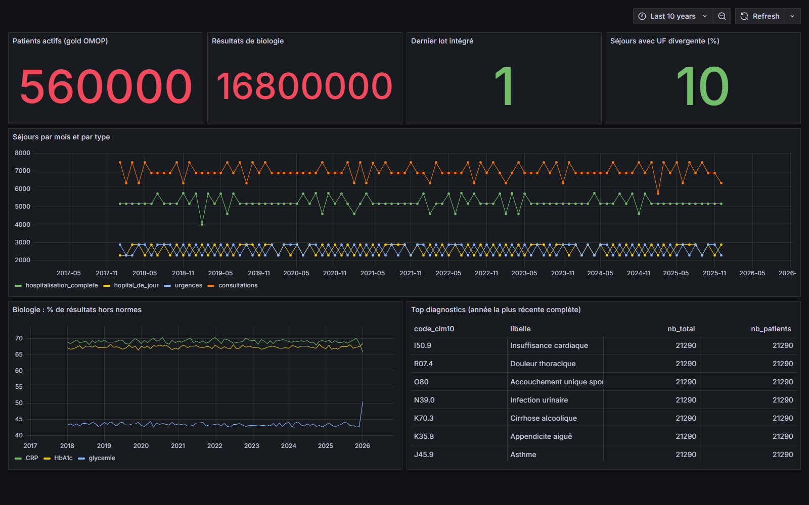
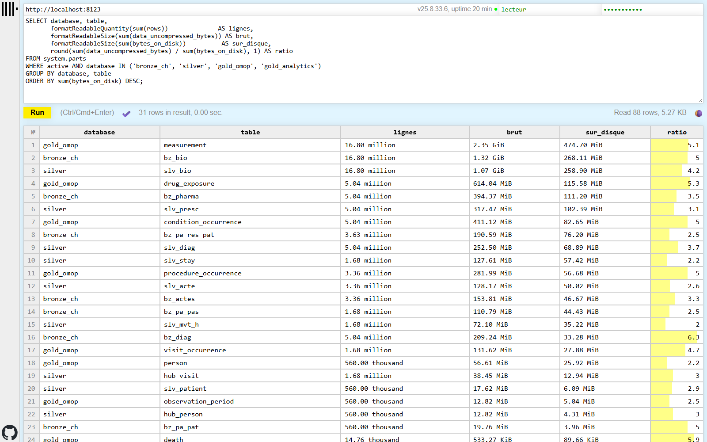
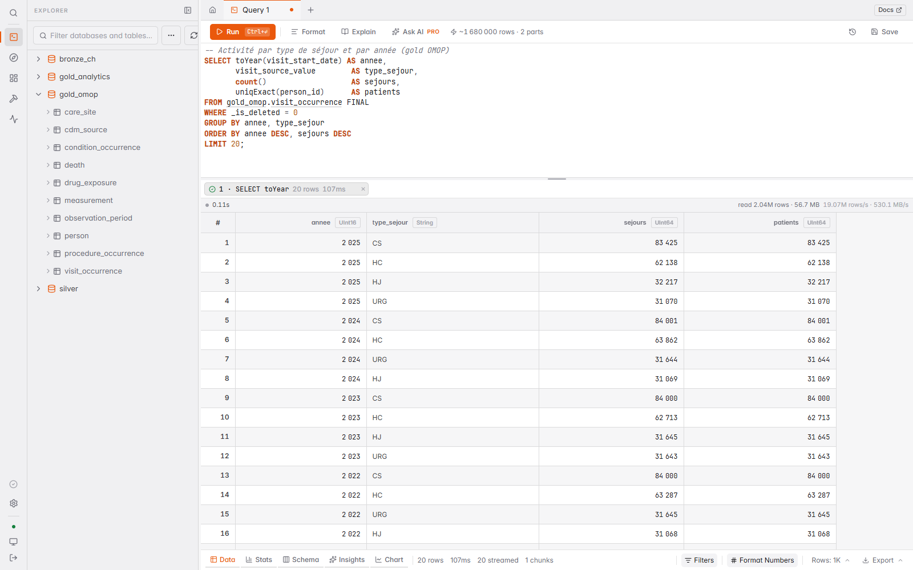
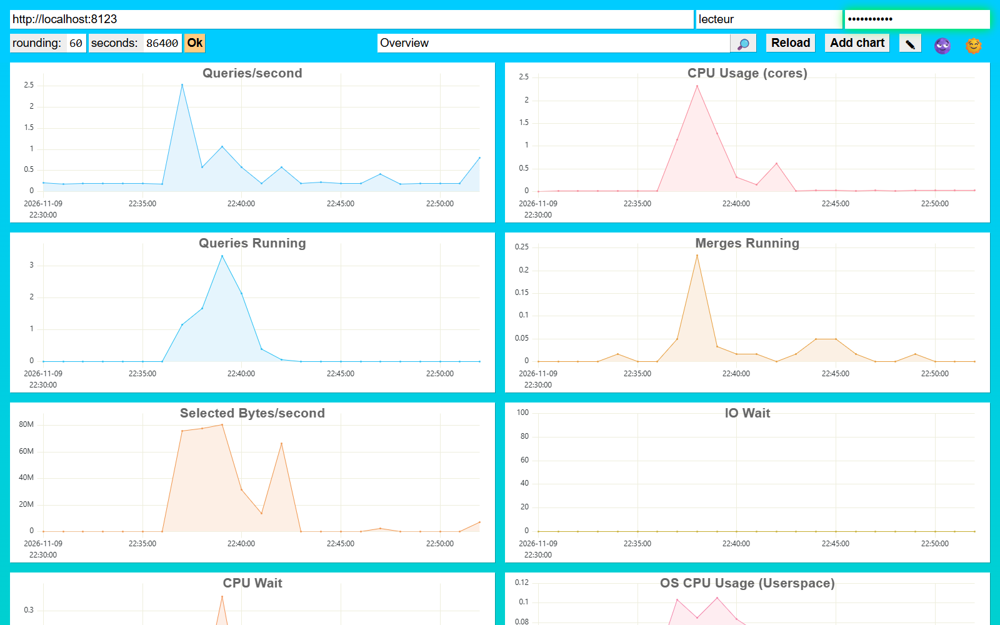

# Lab OMOP — PostgreSQL → ClickHouse (dbt) → releases OMOP PostgreSQL

Lab complet et **100 % fictif** de l'architecture « hub analytique + bases de publication » :

```
PostgreSQL eds.bronze  ──(réplication incrémentale par lot, postgresql() + named collection)──┐
  (≈ 5 Go fictifs, type CORA/Pastel)                                                           ▼
                                                    ClickHouse  bronze_ch  →  silver  →  gold_omop  →  gold_analytics
                                                                (répliques)  (canonique,  (OMOP 5.4,     (marts Grafana)
                                                                             hubs d'ID,   continu,
                                                                             dédup, dict) suppr. logique)
                                                                                    │
                     release figée (COPY en flux, index après, bascule atomique)    ▼
PostgreSQL omop.cdm  ◄────────────────────────────────────────────────────────────────  (OHDSI : ATLAS, Achilles, DQD)
```

Interfaces : **CH-UI** (SQL web), console ClickHouse `/play` et `/dashboard`, **Grafana** (tableau de bord provisionné), DBeaver en option.

## Aperçu

Captures prises sur une exécution complète à `SCALE=1` : 560 000 patients, 1,68 M séjours, 16,8 M résultats de biologie, 5 M diagnostics et prescriptions.

### Grafana : tableau de bord « Lab OMOP — activité et qualité »

Indicateurs lus dans `gold_omop` / `gold_analytics` : patients actifs, volume de biologie, dernier lot intégré, qualité (UF divergente), activité mensuelle par type de séjour, taux de résultats hors normes, top diagnostics CIM-10.



### ClickHouse : volumétrie et compression par couche

Requête n° 1 de `sql/exemples_clickhouse.sql` dans la console intégrée `/play`. On suit chaque table de `bronze_ch` → `silver` → `gold_omop`, avec un taux de compression de ×2 à ×6 selon les tables.



### CH-UI : explorer le modèle OMOP en SQL

Les quatre couches dans l'explorateur, et une requête d'activité par année et par type de séjour sur `gold_omop.visit_occurrence` (lecture dédupliquée `FINAL`, 2 M lignes en ~0,1 s).



### ClickHouse : tableau de bord serveur

Métriques natives (`/dashboard`) pendant le pipeline : pics de requêtes, de CPU et de merges lors du build dbt et de la publication.



### Benchmark : PostgreSQL (`cdm`) vs ClickHouse (`gold_omop`)

Mêmes données (16,8 M lignes dans `measurement`), mêmes questions, meilleur temps sur 3 exécutions (`make bench`) :

| Requête | PostgreSQL (ms) | ClickHouse (ms) | Gain |
|---|---:|---:|---:|
| Biologie : volume et moyenne par analyse et année | 1 370 | 254 | ×5,4 |
| Top 10 diagnostics (patients distincts) | 1 741 | 94 | ×18,5 |
| Créatinine mensuelle des plus de 75 ans (jointure `person`) | 221 | 80 | ×2,7 |
| Activité par UF et par mois (visites, patients distincts) | 2 047 | 53 | ×38,3 |
| Prescriptions : durée moyenne par médicament et voie | 331 | 160 | ×2,1 |
| Parcours d'un patient : toute sa biologie (accès ponctuel) | 1,3 | 71 | ×0,02 |

Les agrégations analytiques vont de 2 à 38 fois plus vite sur ClickHouse. Pour lire un seul patient, PostgreSQL et ses index restent imbattables. D'où l'architecture : ClickHouse comme hub analytique, des releases OMOP figées dans PostgreSQL pour les outils OHDSI.

---

## 1. Prérequis

| | Minimum | Recommandé (SCALE=1) |
|---|---|---|
| Docker + Docker Compose v2 | oui | oui |
| RAM | 8 Go (avec `SCALE=0.3`) | 16 Go |
| Disque libre | 10 Go (avec `SCALE=0.3`) | 25 Go |
| `make`, `bash`, `curl` | oui (Windows : WSL2, ou Git for Windows + `winget install ezwinports.make`) | |

Répartition du disque à `SCALE=1` : bronze Postgres ≈ 5 Go, chaque release OMOP Postgres ≈ 5,5 Go (active + 1 archivée), ClickHouse ≈ 1,5 Go (compression mesurée ≈ ×8,5), plus les images Docker.

Derrière un proxy d'entreprise : configurer le proxy du démon Docker, et si besoin `PIP_INDEX_URL=<miroir interne>` dans `.env` pour construire l'image dbt.

## 2. Démarrage

```bash
cp .env.example .env   # puis ajuster les mots de passe si besoin
```

```bash
make up            # Postgres, ClickHouse, CH-UI, Grafana + construction de l'image dbt
make generate      # ≈ 5 Go fictifs dans Postgres (premier essai rapide : make generate SCALE=0.1)
make dbt           # bronze_ch -> silver -> gold_omop -> gold_analytics + tests (59 nœuds)
make publish       # release OMOP figée dans Postgres (schéma cdm)
make bench         # Postgres (cdm) vs ClickHouse (gold_omop), mêmes données, mêmes questions
make ui            # rappel des adresses
```

`make all` enchaîne tout. `make help` liste les commandes.

## 3. Interfaces graphiques

| Outil | Adresse | Connexion | Usage |
|---|---|---|---|
| **CH-UI** (inclus) | http://localhost:3488 | URL `http://clickhouse:8123` (pré-remplie), user `lecteur` / `lecteur_pwd` | Éditeur SQL, explorateur de tables, historique |
| Console ClickHouse (intégrée) | http://localhost:8123/play | user `lecteur` / `lecteur_pwd` | SQL rapide, sans rien installer |
| Tableau de bord ClickHouse (intégré) | http://localhost:8123/dashboard | idem | Métriques serveur (requêtes, mémoire, merges) |
| **Grafana** (inclus) | http://localhost:3000 | `admin` / `admin_lab` → dossier **Lab OMOP** | Tableau de bord activité/qualité déjà configuré |
| DBeaver Community (à télécharger, gratuit) | dbeaver.io | ClickHouse : `localhost:8123`, user `lecteur` · Postgres : `localhost:5432`, user `lab` | Client SQL desktop, Postgres et ClickHouse côte à côte |

Requêtes d'exploration prêtes à coller : `sql/exemples_clickhouse.sql` (compression par couche, lots, suppressions logiques, hubs d'ID, mapping, cohorte, dictionnaire, requêtes lentes).

## 4. Ce que montre chaque couche

**Bronze Postgres (`eds.bronze`)** — tables type CORA/Pastel : `pa_pat`, `pa_pas`, `pa_res_pat` (M/H), `diag` (CIM-10), `actes`, `bio`, `pharma`, `pat_opposition`, `ref_vocab_map`. Insertion seule avec `_batch_id`. Pièges volontaires : doublons d'hébergement H, versions « ouvertes » (`per_fin` NULL), UF divergentes (~10 %), séjours en cours.

**`bronze_ch`** — répliques ClickHouse. Le watermark `_batch_id > N` est calculé par dbt et **poussé à Postgres** : seuls les nouveaux lots transitent. Index BRIN sur `_batch_id` côté Postgres.

**`silver`** — modèle canonique :
- `hub_person` / `hub_visit` : **identifiants OMOP stables** (attribués une seule fois, insertion seule) ;
- `slv_mvt_h` : dédup CORA en une ligne (`ORDER BY … per_fin DESC NULLS LAST … LIMIT 1 BY pas_ips, per_deb`) ;
- `slv_stay` : séjour + UF médicale + UF d'hébergement + indicateur de divergence ;
- `dict_vocab` : **dictionnaire en mémoire** (code source → concept), lookup `dictGet` sans jointure ;
- `slv_diag/acte/bio/presc` : événements incrémentaux par lot.

**`gold_omop`** — OMOP CDM 5.4 (`person`, `observation_period`, `visit_occurrence`, `condition_occurrence`, `procedure_occurrence`, `measurement`, `drug_exposure`, `death`, `care_site`, `cdm_source`) :
- `ReplacingMergeTree(_version, _is_deleted)` : lecture avec `FINAL` ;
- événements **incrémentaux**, triés par `(concept, person_id, id)` pour les cohortes ;
- **oppositions** : lignes déjà publiées ré-émises avec `_is_deleted = 1` → disparaissent à la release suivante ;
- `person_source_value` = SHA-256 tronqué de l'IPP (jamais l'IPP en clair).

**`gold_analytics`** — marts pour Grafana : activité mensuelle, biologie mensuelle (médiane, P95, % hors normes), diagnostics annuels.

## 5. Alimentation continue

```bash
make increment     # nouveau lot : séjours récents, correction d'UF, décès, oppositions
make dbt           # n'importe et ne transforme que ce lot ; les hubs gardent les mêmes ID
make publish       # nouvelle release ; `make rollback` revient à la précédente instantanément
```

## 6. Releases OMOP (blue/green)

`scripts/publish_omop_release.sh` :
1. crée `cdm_AAAAMMJJ_HHMMSS` ;
2. charge les tables **en parallèle** (`PARALLEL=4`) par flux `ClickHouse TSV → COPY`, sans fichier intermédiaire ; table créée dans la même transaction que le COPY ;
3. crée PK et index OHDSI **après** chargement, puis `ANALYZE` ;
4. compare les volumes ClickHouse/Postgres et **annule tout** en cas d'écart ;
5. bascule atomique : l'ancien `cdm` est archivé, la nouvelle release devient `cdm` ;
6. garde `KEEP_RELEASES` releases archivées. Historique dans `omop.public.omop_release`.

Les outils OHDSI pointent toujours sur `cdm` : aucune reconfiguration à chaque release.

## 7. Optimisations appliquées

| Où | Optimisation |
|---|---|
| Génération | Fonctions SQL déterministes inlinées (aucune jointure), 7 tables en parallèle, index créés après |
| Postgres | `postgresql.conf` ETL (mémoire, parallélisme, WAL) ; BRIN sur `_batch_id` ; `wal_level=minimal` → COPY sans WAL |
| Réplication | Filtre incrémental littéral poussé à Postgres ; rôle `ch_reader` en lecture seule ; named collection (aucun mot de passe en SQL) |
| ClickHouse | `LIMIT 1 BY` / `argMax` pour la dédup ; dictionnaire `COMPLEX_KEY_HASHED` ; tri des faits par concept ; bloom filter sur `person_id` ; débordement disque des gros GROUP BY / tris (profil `etl`) |
| Gold | Incrémental par lot + suppressions logiques ; dimensions reconstruites (quelques secondes) |
| Publication | Flux parallèles, plus grosses tables d'abord, index après chargement, bascule atomique |
| Sécurité | Utilisateur `lecteur` en lecture seule pour les interfaces ; `default` limité au conteneur ; pseudonyme au lieu de l'IPP |

## 8. Validation effectuée

Projet testé de bout en bout (Postgres 16 et moteur ClickHouse 26.9 via chDB, dbt-core 1.12.6 + dbt-clickhouse 1.10.3) :
- génération (SCALE 0,05 → 248 Mo, soit ≈ 5 Go à SCALE=1) ;
- `dbt build` complet puis 3 lots incrémentaux : 59/59 modèles + tests à chaque fois ;
- répliques sans doublon, ID stables, suppressions logiques masquées par `FINAL` ;
- releases, contrôle des volumes, retour arrière.

Benchmark indicatif à cette petite échelle :
- ClickHouse ×2 à ×6 plus rapide sur les agrégations ;
- Postgres plus rapide sur les accès ponctuels indexés (un patient, une cohorte très sélective).

C'est exactement le découpage de l'architecture : calcul lourd et analytique dans ClickHouse, OHDSI et accès ponctuels dans Postgres. **Lance `make bench` à 5 Go pour tes propres chiffres.**

## 9. Passer à de vraies données

- Remplacer `bronze.ref_vocab_map` (concept_id **fictifs** > 2 000 000 000) par les vocabulaires **Athena** : `source_to_concept_map` / `concept_relationship` « Maps to ».
- Charger les tables de vocabulaire OMOP dans la base de publication pour ATLAS.
- Vérifier `cdm_version_concept_id` (var dbt) dans ton Athena.
- **Production** : remettre `wal_level` (`replica`, ou `logical` pour un CDC type PeerDB) et `synchronous_commit = on` ; changer tous les mots de passe ; chiffrement, journalisation et hébergement conformes HDS.
- Après une mise à jour des mappings : `docker compose run --rm dbt build --full-refresh`.

## 10. Dépannage

| Symptôme | Piste |
|---|---|
| `make generate` lent ou saturé | Baisser `SCALE`, augmenter la RAM Docker, ajuster `shared_buffers` dans `postgres/postgresql.conf` |
| dbt : `AUTHENTICATION_FAILED` sur `dictGet` | `CH_PASSWORD` du `.env` différent de celui du conteneur → `make down && make up` |
| ClickHouse ne lit pas Postgres | `PG_CH_READER_PASSWORD` modifié après le 1er démarrage → recréer le rôle ou `make clean` |
| Grafana sans plugin | Le conteneur télécharge le plugin au démarrage : il faut un accès Internet ou un proxy |
| Mémoire ClickHouse | Profil `etl` dans `clickhouse/users.d/lab.xml` ; ajouter `join_algorithm = 'grace_hash'` pour des jointures plus grosses que la RAM |
